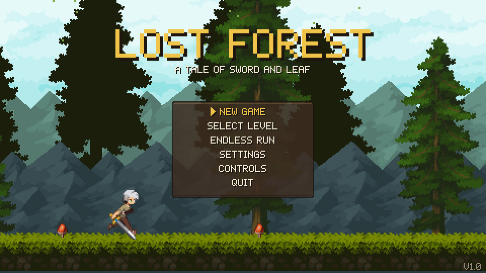
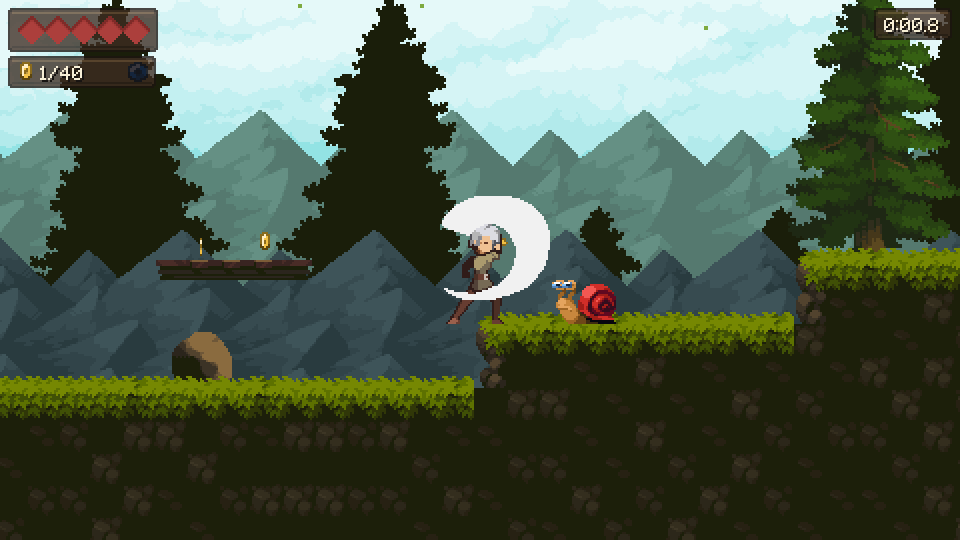
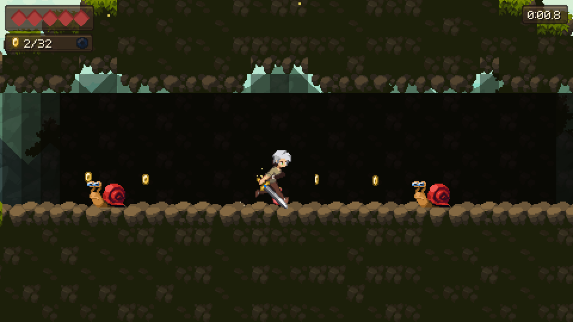
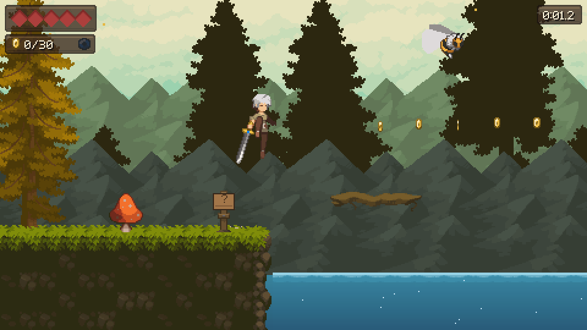
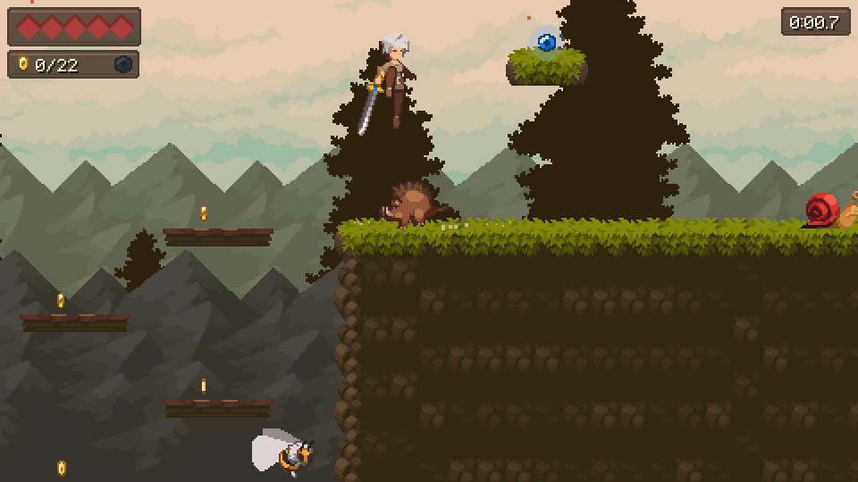
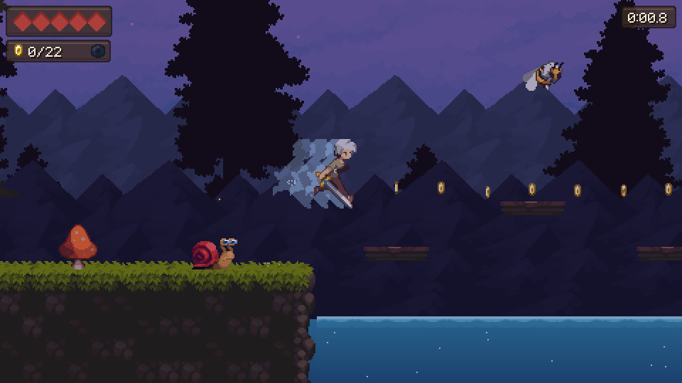
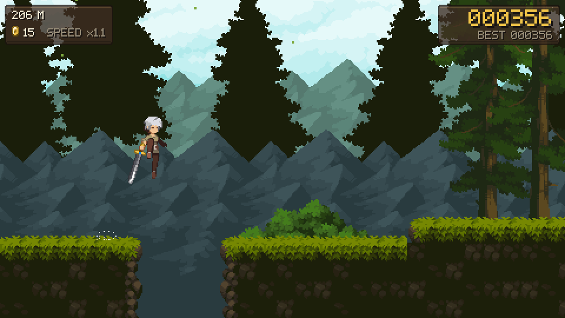

# Lost Forest

A 2D pixel-art action platformer built with **Python + pygame-ce**.
Guide a white-haired swordsman through five forest levels: run, double jump, dash, slash
snails, boars and bees, find keys, chests and one secret gem per level.



## Screenshots

| | |
|:---:|:---:|
|  |  |
| **Forest Edge**: the sword combo against a snail | **Mossy Hollow**: a snail-filled cave |
|  |  |
| **Bee Grove**: bees over a drifting-log crossing | **Autumn Ridge**: the ridge top and its secret gem |
|  |  |
| **Heart of the Forest**: a mid-air dash at dusk | **Endless Run**: how far can you get? |

## Run it

```bash
pip install -r requirements.txt
python main.py
```

Requires Python 3.10+ and `pygame-ce`. Or grab a packaged `LostForest.exe` (see
[Build a shareable .exe](#build-a-shareable-exe)), which needs no Python at all.

## Controls

| Action         | Keyboard + mouse          | Gamepad        |
|----------------|---------------------------|----------------|
| Move           | A / D (arrows also work)  | D-pad / stick  |
| Jump / double  | Space                     | A              |
| Attack         | Left click / X            | X / B          |
| Combo          | Attack twice              | Attack twice   |
| Dash (air too) | Right click / Shift       | RB / LB        |
| Fast drop      | Hold S in mid-air         | Hold down      |
| Drop through   | S while on a plank        | Down on plank  |
| Interact       | W (doors, chests)         | Up             |
| Pause          | Esc / P                   | Start          |
| Fullscreen     | F11 / Alt+Enter           |                |

Menus work with the keyboard (W/S or arrows + Enter) or the mouse (hover + click; on
option rows left-click raises a value and right-click lowers it).

## Endless Run

Pick **ENDLESS RUN** on the title screen. The hero runs on his own through a forest that is
generated as you go, and it never repeats. Press **Space** or **click** to start, then jump,
double jump, dash, fast drop and attack to survive. One hit ends the run, and so does
running into a raised step. Jump onto it! (If your feet are only a few pixels short of the top,
you are helped up.)

- The run speeds up slowly and steadily: from 150 px/s to a top speed of 290 px/s after about
  2.5 minutes. New obstacles unlock as you go: spikes and snails at first, then pits and water,
  bees and steps, then charging boars, plank bridges and combos. Gap widths scale with your
  speed, so every gap stays jumpable.
- Every enemy goes down in **one sword hit or stomp** and gives **+25 points** right away.
- **Score** = metres run + 10 per coin + 25 per enemy defeated.
- The forest changes colour every 500 m, and every 250 m is marked with a chime.
- Your **best score**, **best distance** and **number of runs** are saved and shown on the
  start screen. Beat your record and the game-over card flashes **NEW BEST SCORE!**

Tuning (start and maximum speed, acceleration, points) lives in the *Endless Run* block of
`lostforest/settings.py`.

## Features

- Tight platforming: variable jump height, coyote time, jump buffering, double jump
- Dash on the ground or once per jump in mid-air (with afterimages), dash-jump, fast drop
- Two-hit sword combo, enemy stomping, knockback and invulnerability frames
- Enemies with their own behaviour:
  - **Snail** hides in its armoured shell after a hit
  - **Boar** spots you, telegraphs, and charges until it hits a wall
  - **Bee** hovers, buzzes, then dive-bombs
- Moving logs, crumbling planks, one-way platforms, water and spike hazards
- Lamp checkpoints, signs, keys, locked doors, chests, potions, coins, secret gems
- 5 themed levels (green, spring, golden, autumn, dusk) with parallax backgrounds
- **Endless Run** mode with a procedurally generated course and a saved best score
- Title, level select, pause, settings, controls, game-over and results screens
- Save file with unlocked levels, best times, best coin counts, gems and Endless records
- Synthesised chiptune sound effects and music (no audio files required)

## Project layout

```
Lost Forest/
├── main.py                  entry point
├── Assets/                  art pack (untouched)
├── levels/                  level files (plain text - see levels/README.md)
├── lostforest/
│   ├── settings.py          screen size, physics and enemy tuning
│   ├── app.py               window, fixed-timestep main loop, hotkeys
│   ├── core/                engine pieces
│   │   ├── assets.py        every sprite-sheet rectangle in the art pack
│   │   ├── animation.py     animations with anchors, flipping, hit-flash
│   │   ├── audio.py         synthesised SFX + music, optional file overrides
│   │   ├── camera.py        smooth follow, look-ahead, shake
│   │   ├── font.py          built-in 5x7 pixel font
│   │   ├── input.py         keyboard + gamepad action mapping
│   │   ├── particles.py     dust, sparks, leaves, fireflies
│   │   ├── save.py          JSON save data
│   │   └── scene.py         scene stack with fade transitions
│   ├── world/
│   │   ├── tiles.py         tile kinds + auto-tiling rules
│   │   ├── tilemap.py       collision queries, pre-rendered terrain, water
│   │   ├── background.py    parallax layers and colour themes
│   │   ├── level.py         level file parser + running level
│   │   └── runner.py        Endless Run: streaming world, course generator, scoring
│   ├── entities/
│   │   ├── base.py          physics body and tile collision
│   │   ├── player.py        the hero
│   │   ├── enemies.py       Snail, Boar, Bee
│   │   ├── items.py         coins, gem, potion, key, chest
│   │   └── objects.py       checkpoints, doors, signs, platforms, decoration
│   ├── scenes/              title, level select, gameplay, endless, overlays, results, options
│   └── ui/                  HUD, menus/panels, animated menu backdrop
├── docs/screenshots/        README screenshots (made by tools/screenshots.py)
├── tools/
│   ├── build_exe.py         build the small, shareable dist/LostForest.exe
│   ├── level_tool.py        validate levels / render full-map previews
│   ├── screenshots.py       render the README screenshots from the game
│   └── smoke_test.py        headless test of menus, mechanics and every level
└── saves/                   created at runtime (save game + music cache)
```

## Build a shareable .exe

```bash
pip install pyinstaller
python tools/build_exe.py
```

This produces a single `dist/LostForest.exe` (about 6 MB) that runs on any 64-bit Windows 10/11
PC without Python installed. To keep it small, the build bundles only the images the game actually
loads (with unused parts of sprite sheets blanked out), leaves out unused Python libraries and pygame
DLLs, and strips docstrings. The packaged game saves progress (and caches its generated music) in
`%APPDATA%\LostForest`. If it ever crashes, the error is written to `crash.log` in that folder.

`LostForest.exe --level 3` (or `python main.py --level 3`) starts directly in a level, and
`--endless` opens Endless Run directly, which is handy for testing.

## Making changes

- **Tune the feel**: edit `lostforest/settings.py` (jump height, run speed, enemy speed/HP...).
- **Edit or add levels**: see [`levels/README.md`](levels/README.md). Levels are loaded in
  file-name order, so `06_my_level.txt` becomes level 6 automatically.
- **Check your levels**: `python tools/level_tool.py check` and
  `python tools/level_tool.py preview` (writes PNGs to `tools/previews/`).
- **Run the tests**: `python tools/smoke_test.py` (add `--shots` to save debug screenshots to `tools/shots/`).
- **Refresh the README screenshots**: `python tools/screenshots.py`.
- **Custom audio**: drop files into `Assets/Audio/sfx/<name>.wav|ogg` or
  `Assets/Audio/music/<menu|forest>.ogg|wav|mp3`. Sound names are listed in
  `build_sfx()` in `lostforest/core/audio.py` (jump, coin, hit, hurt, ...).
- **Reset progress**: Settings → Reset Progress, or delete `saves/savegame.json`.
